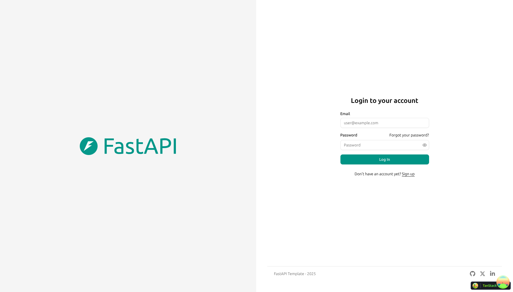
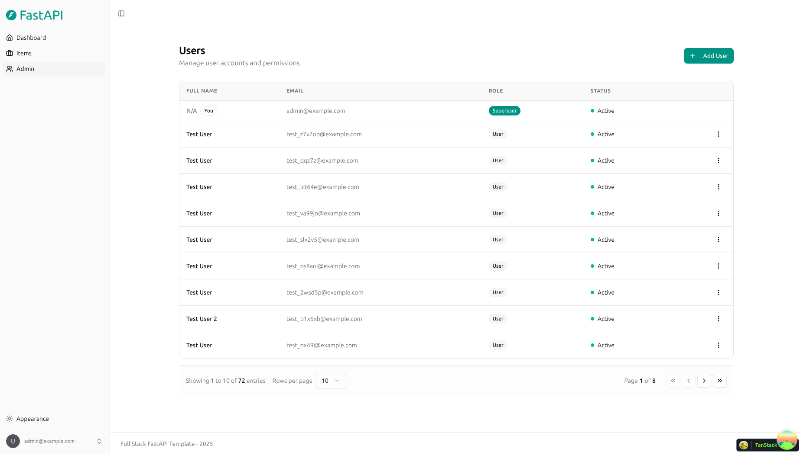
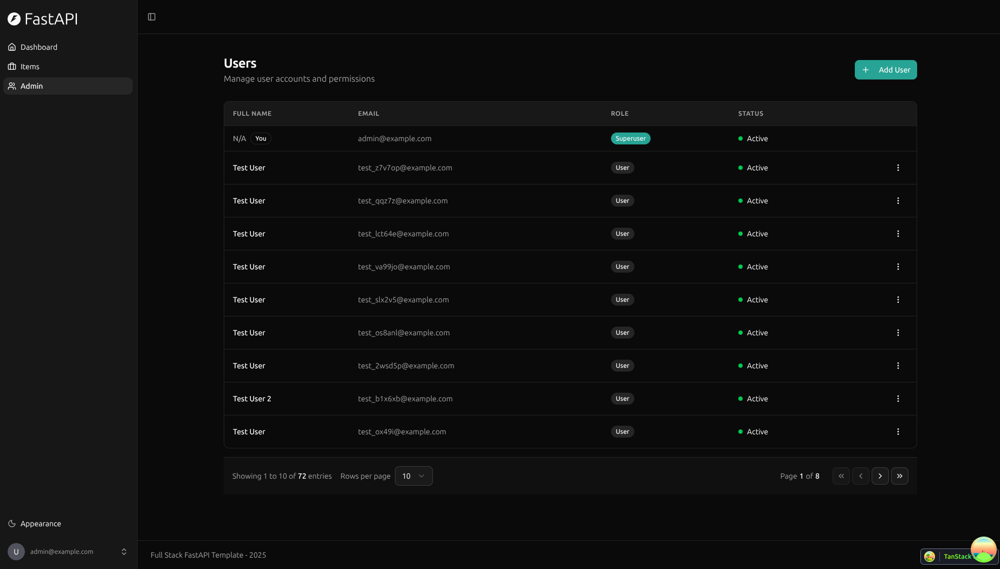
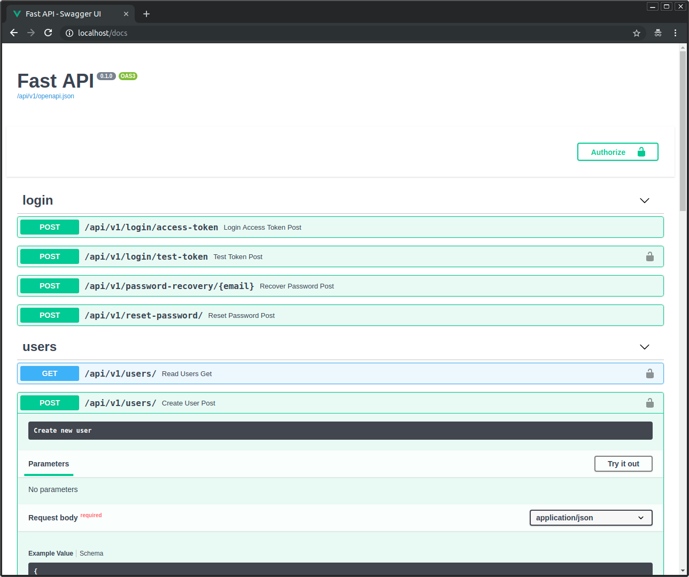

# Full Stack FastAPI Template

[](../../actions/workflows/test-docker-compose.yml)
[](../../actions/workflows/test-backend.yml)

一个面向内部系统的全栈模板：FastAPI + React、用户编码/姓名登录、管理员账号管理，以及可直接继承的中英双语脚手架与错误码契约。

## 技术栈与功能

- ⚡ [**FastAPI**](https://fastapi.tiangolo.com)：Python 后端 API。
  - 🧰 [SQLModel](https://sqlmodel.tiangolo.com)：Python SQL 数据库交互（ORM）。
  - 🔍 [Pydantic](https://docs.pydantic.dev)：由 FastAPI 使用，负责数据校验与配置管理。
  - 💾 [PostgreSQL](https://www.postgresql.org)：SQL 数据库。
- 🚀 [React](https://react.dev)：前端框架。
  - 🧩 前端构建产物由 FastAPI 托管，与 API 使用同一域名。
  - 💃 使用 TypeScript、hooks、[Vite](https://vitejs.dev) 等现代前端技术栈。
  - 🎨 使用 [Tailwind CSS](https://tailwindcss.com) 和 [shadcn/ui](https://ui.shadcn.com) 构建组件。
  - 🤖 自动生成前端客户端，不手工维护 API 请求类型。
  - 🧪 使用 [Playwright](https://playwright.dev) 进行端到端测试。
  - 🦇 支持深色模式。
  - 🌐 使用 `i18next` 与 `react-i18next` 提供简体中文和英文界面。
- ☁️ 支持部署到 [FastAPI Cloud](https://fastapicloud.com)。
- 🐋 使用 [Docker Compose](https://www.docker.com) 运行本地服务或自托管部署。
  - 📞 使用 [Traefik](https://traefik.io) 作为反向代理，自动处理 HTTPS。
- 🔒 默认使用安全的密码哈希。
- 🔑 使用 JWT（JSON Web Token）认证。
- ✅ 使用 [Pytest](https://pytest.org) 测试后端。
- 🏭 基于 GitHub Actions 的持续集成（CI）与持续部署（CD）。

## 模板继承：i18n 脚手架与错误码契约

在 GitHub 仓库页点击 **Use this template** 创建派生仓库后，即可直接继承现有中英双语能力，无需重新搭建语言检测、持久化或错误提示链路。字典随前端本地打包，不发起额外的语言资源 HTTP 请求，也不引入语言检测插件。

### 语言检测与界面文案

`frontend/src/i18n.ts` 在渲染前初始化，按以下顺序确定语言：

1. 读取 `localStorage` 中的 `app-language`；仅接受 `zh-CN` 或 `en`。
2. 未存储有效偏好时读取 `navigator.language`：中文（`zh*`）使用 `zh-CN`，其他语言使用 `en`。
3. 字典回退语言为 `zh-CN`。

语言切换器会保存偏好、同步 `<html lang>`，并使路由标题与界面文案即时更新；刷新后仍保留所选语言。语言偏好只保存在当前浏览器中，不写入后端用户账号。

扩展界面时遵循以下约定：

- 在 `frontend/src/locales/zh-CN.json` 与 `frontend/src/locales/en.json` 中同步添加同一组 key；英文也保持全量覆盖。
- 组件使用 `useTranslation()` 的 `t()` 读取文案；表单 zod 校验消息同样来自字典，不写固定文案。
- 路由标题沿用现有 `i18next.t()` 与路由失效重求值机制，不另建语言状态。
- 品牌与产品词（GitHub、X、LinkedIn、Full Stack FastAPI Template）保留原文。

### 业务错误的多语言提示

后端的 `HTTPException.detail` 使用稳定的机器可读错误码和固定英文兜底消息，状态码保持不变：

```json
{
  "detail": {
    "code": "AUTH_LOGIN_INVALID",
    "message": "Incorrect user code/name or password"
  }
}
```

新增业务错误时，按 `AUTH_`、`USERS_` 等模块前缀使用 `UPPER_SNAKE_CASE` 错误码，并同时完成：

1. 在两份字典的 `errors` 组中添加该错误码对应的中英文案。
2. 后端返回 `detail = {"code": "...", "message": "固定英文兜底消息"}`，不要在后端返回本地化文案。
3. 后端测试断言 `detail.code`，不依赖英文提示文案。
4. 后端模型或路由变更后执行 `sh scripts/generate-client.sh`；不要手改 `frontend/src/client/` 下的生成文件。

`frontend/src/utils.ts` 中的 `extractErrorMessage` 是错误提示的统一入口，依次使用当前语言的 `errors.{code}` 字典、`detail.message`、其他既有回退分支。未知错误码因此仍有英文兜底；Pydantic 422 自动校验消息保持原有处理，不做中文化。现有错误码及状态码以 [SPEC-i18n.md](./SPEC-i18n.md) 的契约表为准。

## 账号与数据约定

- 登录使用「用户编码或姓名 + 密码」。后端先匹配 `user_code`，未命中再匹配 `full_name`；重名时须使用用户编码登录。
- 不提供邮箱、SMTP、邮件找回密码或用户自注册功能。账号由管理员创建和管理,系统不提供用户自助注销;用户可在设置页修改资料与密码,并主动登出。
- 初始超级用户通过 `FIRST_SUPERUSER_CODE` 与 `FIRST_SUPERUSER_PASSWORD` 配置。
- 管理员可在用户管理中生成一次性返回的随机临时密码，供用户登录；临时密码不发送邮件，也不强制用户首次登录后修改。
- 新建的 User 使用 Python 3.14 标准库的 UUID v7；既有 UUID v4 数据不回填。

## 快速开始

先启动数据库：

```bash
docker compose up -d db
```

在 `backend/` 目录安装依赖、执行迁移并初始化超级用户，再启动后端：

```bash
cd backend
uv sync
uv run bash scripts/prestart.sh
uv run fastapi dev
```

另开终端，在项目根目录启动前端：

```bash
bun install
bun run dev
```

访问前端 <http://localhost:5173>、后端 API <http://localhost:8000> 或 Swagger UI <http://localhost:8000/docs>。完整命令、Docker Compose 开发方式和测试说明见[开发指南](./development.md)。

## 文档导航

- 后端开发：[backend/README.md](./backend/README.md)
- 前端开发：[frontend/README.md](./frontend/README.md)
- FastAPI Cloud 部署：[deployment.md](./deployment.md)
- Docker Compose 自托管部署：[deployment-docker-compose.md](./deployment-docker-compose.md)
- 认证与账号体系设计：[SPEC.md](./SPEC.md)
- 中英双语与错误码契约设计：[SPEC-i18n.md](./SPEC-i18n.md)

## 界面预览

### 登录页



### 管理页



### 深色模式



### 交互式 API 文档



## 发布记录

见 [release-notes.md](./release-notes.md)。

## 许可证

Full Stack FastAPI Template 根据 MIT 许可证的条款授权。
